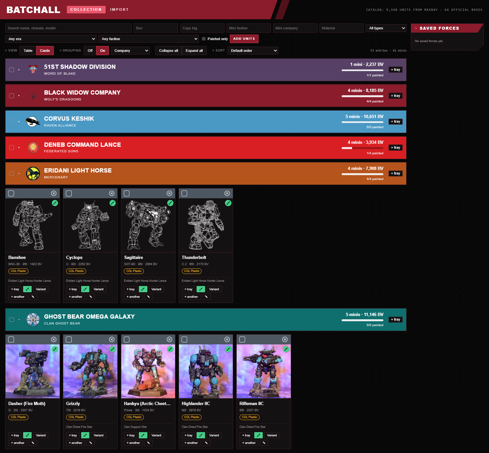
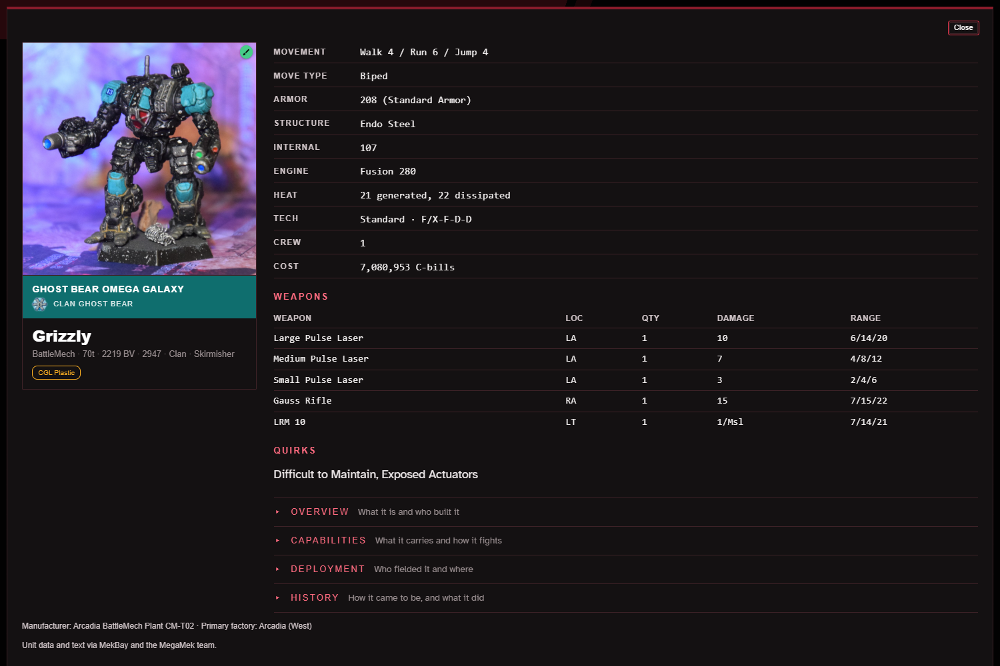
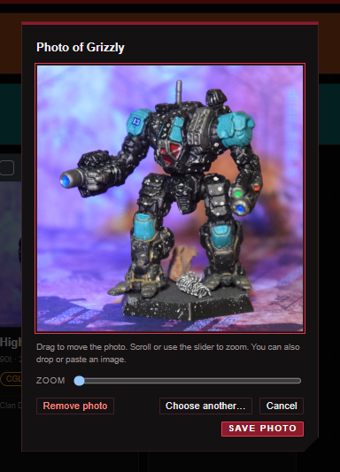
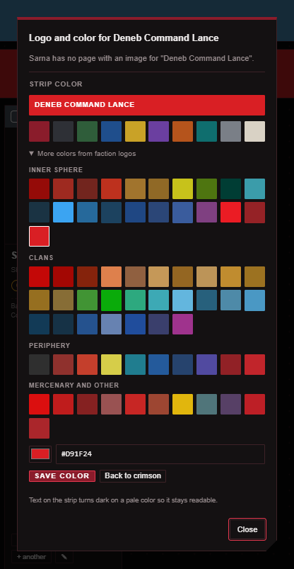

# Batchall

Batchall tracks the BattleTech miniatures you own and builds forces from them at a target Battle Value (BV).
Python 3.12 standard library only. No packages to install.

## Screenshots



Grouping by company gives each company a banner in its own color, with its logo, mini count, total BV and
paint progress. A mini can carry its own photo, which takes the place of the unit's artwork on its card.



The details panel is a larger version of the card, with the unit's stats, weapons and lore. The lore sections
start folded.




Left: a mini's photo is cropped by dragging and zooming, and the whole photo is kept so the crop can be changed
later. Right: the logo and color dialog looks a company's logo up on Sarna, and offers strip colors, including
colors taken from the faction logos.

The photos are the author's own. The unit line art and the faction and company logos belong to their publishers
and artists. The line art comes from MekBay, and the logos from MekBay and Sarna, the BattleTech wiki. They
appear in these screenshots at small size for illustration only. If a rights holder would like any of them
removed, open an issue and they will be taken out.

## Setup

```
python3 -m batchall catalog import     # downloads unit, faction and era data from MekBay (about 27 MB)
python3 -m batchall boxes import       # builds the official box and ForcePack catalog from BattleTechWiki
python3 -m batchall art prefetch       # optional: downloads faction logos and unit art ahead of time
python3 -m batchall serve              # web UI at http://localhost:8765/
```

`boxes import` needs the unit catalog first. It pauses between wiki requests and caches the pages in
`data/box_pages/`, so running it again is fast. Use `--refresh-pages` to download them again.

`art prefetch` is optional. It downloads the 73 faction logos (about 1 MB) plus the illustration for each
unit you own, into `data/art/`. Without it the page fetches each image the first time it needs one, so a
fresh install works either way. Run it after you have added units to your collection if you want the
unit art too, and run `python3 -m batchall art status` to see what is still missing.

The database lives in `data/batchall.db`. Set `BATCHALL_DB` to use a different file, or
`BATCHALL_DATA_DIR` to move the whole data folder.

**Coming from the old name.** This project used to be called BattleTech Collection, with the command
`python3 -m bt` and the database `data/battletech.db`. The first time Batchall opens the default
database it copies `data/battletech.db` to `data/batchall.db`. The old file is only read, so it stays
as a backup, and nothing is copied again once `data/batchall.db` exists. The old settings `BT_DB` and
`BT_DATA_DIR` still work, and a database chosen by a setting or by `--db` is never replaced.

## Running the server

```
python3 -m batchall serve                          # http://localhost:8765/
python3 -m batchall serve --port 9000              # different port
python3 -m batchall serve --host 192.168.1.20      # reachable from other machines at that address (see below)
BATCHALL_DB=/path/to/other.db python3 -m batchall serve  # use a different database
```

The server prints its address and runs until you press Ctrl+C. It uses only the standard library, so
there is nothing to install. The default port is 8765 and the default host is `127.0.0.1`, which
means only the machine running it can connect.

Run `catalog import` once before the first start. Without it the UI loads but the catalog is empty
and the UI shows "Catalog not loaded". The collection is kept when you re-import the catalog.

To open it from another device, such as a phone, start it on this machine's own network address (the
`192.168.1.20` above is an example) and open that same address on the other device. The server only
answers to `localhost` and to the exact address it was started on. With `--host 0.0.0.0` it listens on
every interface but still answers only to `localhost`, so another device gets "forbidden host". Starting
on a network address can take several seconds on some machines while Python looks the address up, and
the server prints its address once it is ready.

The server has no login. Only start it on a network address on a network you trust, since anyone who can
reach the port can read and change the collection.

The global `--db` option goes before the command and works with `serve`:
`python3 -m batchall --db /path/to/other.db serve`. Setting `BATCHALL_DB` (or `BATCHALL_DATA_DIR`) as shown above does the same.

### Importing in the UI

The Import tab accepts a pasted list or a file (`.txt`, `.csv`, `.tsv`) that fills the text box so you
can review it first. Two list formats are supported:

- **Unit names**, one per line: `Atlas AS7-D`, `2x Locust LCT-1V`, `Shadow Hawk SHD-2H x3`.
- **MUL ids or links**, one per line: `1234`, `2x MUL 1234`, or a masterunitlist.info
  `/Unit/Details/1234/...` link. A CSV row that starts with the id also works. About 1,500 catalog
  units have no MUL id and can only be imported by name.

Near matches, ids shared by several catalog entries, and lines with no match are listed for you to
fix. Nothing is guessed.

## What it does

- **Collection.** Unit, quantity owned, quantity painted, and an optional box label. Add from the
  full catalog or import a plain list (`2x Locust LCT-1V`). Near matches are suggested, never guessed.
- **Adding in the UI.** Type a unit name in the Add units panel and pick from the suggestion list
  (arrow keys plus Enter, or click). Each pick adds one copy and tags it with the panel's box label.
- **Box labels.** A label per entry for the box or set the model came in. Type your own, or let an
  official box set it. Filter the table by box, and build a force from one box with `--box`. One
  label per entry: copies of a unit from two different boxes share a label.
- **Official boxes.** Typing in a box field suggests official boxes and ForcePacks next to your own
  labels. In the Add units panel, picking an official box adds every mini that comes in it. Minis
  that do not match exactly one unit go to a review step where you pick a variant or skip. In a
  table row or the filter, an official name only fills the label.
- **Views.** Switch between Table and Cards. The Grouping Off/On switch turns grouping on and off,
  and the dropdown beside it picks the field. Grouping splits either view into collapsible sections with
  counts, total BV and a painted progress bar. The fields are box, era (by debut year), era (every era the unit is available in, so a mini can appear under many), faction
  group, weight class, type, tech base, role, paint status and material. Turning grouping off keeps your field,
  and picking a field turns grouping on. Faction groups use the factions that field a unit in the
  first era it appears, so later captures do not move a Clan mech into the Inner Sphere. Clan-tech
  units also join every Clan group that ever fields them. A mini can sit in several groups, since
  factions share units. Sort by name, type, BV, tons or debut year in either
  view. Compact density shrinks the table rows. Your choices are remembered.
- **Every mini is its own item.** The roster shows one row or card per mini, so three Atlases are
  three cards. Each mini can have a note, a faction and a company for the force it is painted for,
  an optional tag, a material, a painted flag and a box of its own (blank means its unit's box). The
  pencil opens the edit boxes, the brush marks it painted, "+ another" adds one more of that variant
  and × removes that one mini. A mini with a note, faction or company gets a crimson strip on its card
  with its company and faction. The Copy tag, Mini faction, Mini company and Material boxes filter by
  them. Mini faction is the force you painted a mini for, which is separate from the Faction dropdown
  (who fields a unit in the game data). Box filters and box grouping use each mini's own box.
- **Materials.** A card with no material shows a "+ Material" button that opens a dropdown of No
  Material, CGL Plastic, Resin and Metal. A mini with one shows it as a pill you can click to change
  or clear. The pencil and the table's Material column take any other value you type. Group by
  Material lists each material with only the minis made of it.
- **Bulk changes.** Each card has a bar on top with a select box, the chassis name and a round button
  that removes that one mini. In the table the select box is the first column. Tick several minis, or
  shift-click to tick everything between two, and a bar appears at the bottom with how many are
  selected. A box on each group header ticks the whole group, a dash meaning only some are ticked, and
  the box at the top of the table's first column ticks everything shown. The bottom bar then changes all
  the selected minis in one go: **Mark painted** and **Mark unpainted**, **Set material** (No Material,
  CGL Plastic, Resin or Metal), and **Set box…**, **Set faction…** and **Set tag…**, which each open a box
  to type in with the same suggestions as the matching field elsewhere. Each has a button to clear that
  field on all of them, and Apply with nothing typed does nothing, so an empty box never wipes a field
  by accident. **Remove N…** asks once before it removes them, and a unit left with no minis also
  leaves the force tray and any saved forces. Every change is all or nothing, and the selection stays
  so you can make another one. Escape closes an open panel, then clears the selection. A mini that a
  filter hides, or that you remove, drops out of the selection, so a bulk change never touches anything
  you cannot see. Behind it are `PATCH /api/minis` (a list of `ids` and the fields to set) and
  `DELETE /api/minis` (a list of `ids`), up to 5,000 minis at a time.
- **Artwork.** Cards show each unit's illustration, downloaded once from MekBay and cached under
  `data/art/`. Units with no art show a placeholder. `python3 -m batchall art prefetch` downloads the images
  for your whole collection ahead of time.
- **Faction logos.** A mini painted for a faction MekBay lists, like Wolf's Dragoons or Federated Suns,
  shows that faction's logo beside its name, on the card strip and in the table. The logo is matched on
  the exact faction name, ignoring case, so a name MekBay does not list gets no logo and nothing is
  guessed. The Mini faction box suggests all of MekBay's faction names, and a name picked from the
  list gets a logo. Logos come from MekBay's main site, not the data host. They are cached under
  `data/art/factions/` and kept out of git, since they belong to their publishers. A database from before
  logos were stored picks up its logo paths from `data/catalog/factions.json` the next time the server
  starts, so there is nothing to re-import.
- **Variants.** The Variant button on a mini switches just that mini to another variant of the same
  chassis, since a plastic mini can stand for any variant. It joins the entry for that variant, which
  is created if you do not own it yet, and the other minis of the old variant stay put. For a mini
  that came from an official box, the variants on that box's cards (both sides) are listed first
  under "On your box's card".
- **Force builder.** Pick units you own to fit a BV ceiling for a lance (4), augmented lance (6),
  Star (5), Level II (6), Binary (10) or company (12), or any custom size. Optional filters: faction,
  era, tech base, painted only, and a mix of unit kinds (`mech=2,vehicle=1,ba=1`).
- **Combined arms.** Mechs, vehicles (tanks and VTOLs), battle armor, conventional infantry,
  ProtoMechs and aerospace fighters are separate kinds that can be mixed freely.
- **Saved forces.** Named forces with a formation, target and units, shared by the UI and the CLI.
- **Themes.** The `battletech` Claude skill turns a plain-language theme into per-unit weights and
  passes them to the builder. The UI has the same builder without themes.

## How the builder chooses

The search is exact, not greedy. For each unit kind it solves a 0/1 knapsack over (unit count,
total BV), then combines kinds for every mix that fits the formation. A build never exceeds the
target. It lands within `--slack` percent below the target (default 3) when possible. With no theme
the highest BV in that window wins; with a theme the highest weighted score wins. If nothing lands
in the window, the best fit at or under the target is returned and flagged.

## CLI

All commands print JSON. Add `--text` to `build` and `collection list` for readable output.

```
python3 -m batchall collection list --text
python3 -m batchall collection add --name "Atlas AS7-D" --qty 1 --painted 1
python3 -m batchall collection import --file mylist.txt
python3 -m batchall collection import --mul --file mul-ids.txt
python3 -m batchall build --target 5000 --formation star --mix "mech=3,vehicle=1,ba=1" --variants 3 --text
python3 -m batchall build --target 2000 --formation lance --faction "Draconis Combine" --era "Clan Invasion" --text
python3 -m batchall forces save --name "Scrappy Lance" --formation lance --target 2000 --units 12:1,15:2
python3 -m batchall forces list
```

`python3 -m batchall <command> --help` lists every option.

On a multi-user database (see below) the CLI takes `--user HANDLE` before the command to act as that account, and defaults to the first administrator. `--user` on a single-user database is an error, and `serve` is refused on a multi-user one.

## Hosting for several people

Local mode (everything above) needs no installs and no accounts. This section is only for running one shared server where each person has their own collection. The command line still works on a hosted database and still needs nothing beyond the standard library.

Install the hosted requirements in a virtual environment:

```
python3 -m venv .venv
.venv/bin/pip install -r requirements-hosted.txt
```

Settings come from environment variables:

- `BATCHALL_SECRET`: required, at least 32 characters. Rotating it invalidates outstanding invite codes and signed-in sessions.
- `BATCHALL_ALLOWED_HOSTS`: comma-separated host names the site answers to.
- `BATCHALL_TRUSTED_ORIGINS`: comma-separated origins such as `https://batchall.example.org`.
- `BATCHALL_HTTPS=1`: serve with secure cookies and HTTPS-only settings.
- `BATCHALL_TRUSTED_PROXY=1`: take the client address from the proxy's `X-Forwarded-For`. Set it only behind a proxy you control.
- `BATCHALL_ACCOUNTS_DB`: path of the accounts database (default `data/accounts.db`).
- `BATCHALL_DEBUG=1`: Django debug mode, for trying things locally only.

Setup, in this order:

```
.venv/bin/python manage.py migrate
.venv/bin/python manage.py adopt --handle rose
sqlite3 data/batchall.db "VACUUM"
chmod 700 data data/users
.venv/bin/python manage.py createinvite
.venv/bin/python manage.py collectstatic --noinput
```

- `adopt` creates the first administrator and moves the existing collection, minis, photos, forces and company data into that account. Stop the single-user app first, because the database is locked while it runs. Run the hosted server only after `adopt`; until then `/api/` answers 503.
- Vacuum the shared database after `adopt`. The freed pages still hold the old photo and logo bytes until then.
- `createinvite` prints a one-use sign-up code. Give it to the person joining.
- On a fresh host with no existing data, run `python3 -m batchall catalog import` first. `adopt` refuses to run when the shared database is missing. Then run `manage.py migrate`, `adopt` and `createinvite` in that order.
- `adopt` writes `data/batchall.db.pre-multiuser` before it changes anything. Keep it as the rollback. It still holds the old photos and logos, so delete it once you no longer need to roll back.
- `data/battletech.db`, the copy from before the rename (see above), may still exist with the old data. Delete it deliberately once you are satisfied with the move.
- Never delete `accounts.db` on its own. Account ids index the files in `data/users/`, so restore `accounts.db` together with `data/users/`. Sign-up refuses an account id that already has a data file.
- The admin login at `/admin/login/` is rate limited like the API sign-in: five wrong passwords for one handle from one address lock that pair for five minutes, so an operator who locks themselves out waits five minutes. `/admin/` may also be restricted at the proxy.
- `manage.py changepassword` and `manage.py createsuperuser` apply the same password rules as sign-up (10 to 256 characters, stored in NFC form).
- With `BATCHALL_DEBUG` unset, `runserver` does not serve static files, so the admin site looks unstyled. Use `collectstatic` plus the proxy, or set `BATCHALL_DEBUG=1` for local experiments only.

Try it with `.venv/bin/python manage.py runserver`. For production run gunicorn behind a reverse proxy:

```
.venv/bin/gunicorn hosted.wsgi --workers 1 --threads 4
```

The sign-in rate limiters keep their counts in each process, so lockouts are per gunicorn worker. One worker with several threads keeps a single count. With more workers an attacker gets the limit once per worker.

A Caddy site that forwards the host and protocol and serves static files itself:

```
batchall.example.org {
    handle /static/* {
        root * /path/to/battletech/data
        file_server
    }
    reverse_proxy 127.0.0.1:8000 {
        header_up Host {host}
        header_up X-Forwarded-Proto {scheme}
    }
}
```

`manage.py check --deploy` reports a few warnings that are policy for the proxy and host, not the app: W005, W008 and W021 cover HSTS subdomains and preload and the SSL redirect. W009 appears when the secret is short or weak, as the test key is.

Back up `data/accounts.db`, the shared `data/batchall.db` and every file in `data/users/` with SQLite's backup command, which is safe while the server runs:

```
sqlite3 data/accounts.db ".backup /backups/accounts.db"
sqlite3 data/batchall.db ".backup /backups/batchall.db"
sqlite3 data/users/1.db ".backup /backups/users-1.db"
```

### Sharing a collection by link

A signed-in user can let other people look at their collection without an account. Nothing is shared until its owner creates a link.

- Click **Share** in the account box, then **Create link**. The dialog shows the link (`/s/<token>/`) with a Copy button.
- **New link** replaces it. The old link stops working at once.
- **Turn off** removes the link. Creating one later gives a different address.

Anyone with the link gets the normal view of that collection with every edit control removed. They see all of it: minis, notes, tags, photos and saved forces. They can use Build for me and the force tray, but nothing they do is saved. The server refuses every write on a shared address and opens the owner's data read-only. The one request it accepts besides reads is Build for me, which stores nothing.

The token is long and random, so it cannot be guessed. It is not a password, though: anyone who has the link can look. Treat it like a private URL. If it gets passed further than you meant, make a new link or turn it off.

After a link is turned off, a browser that already opened it can keep showing its images (photos, logos and art) for up to a day from its cache. The link also appears in web server and proxy access logs, so keep it out of any logs you share.

Local mode has no accounts and no sharing.

## Data

Unit stats, BV, and faction availability come from MekBay's public data files at `db.mekbay.com`
(MekBay is open source: https://github.com/MegaMek/mekbay). Check MekBay's terms before
redistributing the data. The downloaded files are cached in `data/catalog/` and are not committed.

Formation sizes follow BattleTechWiki: a lance is four units, an augmented lance adds two vehicles or
battle armor squads to four BattleMechs, a Star is five, a Binary is two Stars, and a Level II is six
Level I units.

Unit artwork also comes from MekBay's public host. It covers about 81% of units (nearly all mechs and
vehicles) and belongs to its publishers. It is cached for your own use, kept out of git, and should not
be redistributed. After upgrading from an older version, run `python3 -m batchall catalog import` once so
units get their art paths.

Box contents come from BattleTechWiki, a fan-maintained source, so they can be wrong or incomplete.
Each box keeps a link to its page. The variant added for a mini is the first one printed on the box's
Alpha Strike card. In testing, about 83% of minis matched exactly one MekBay unit on their own.
Core boxed sets come from a short list in `batchall/boxes.py`; ForcePacks come from the wiki's list.
Design notes are in `docs/box-catalog-design.md`.

## Limits

- Classic BattleTech BV only. Alpha Strike point values are stored but unused.
- BV is the unit's base value with no pilot skill adjustment.
- Battle armor is one entry per squad size (MekBay lists `Sqd4`, `Sqd5`, `Sqd6` separately), and each
  entry fills one slot.
- With a faction or era filter, units with no availability data are skipped and counted in the output.

## License

The code in this repository is MIT licensed (see `LICENSE`). That covers the code only. The MekBay
data, unit artwork, lore text and BattleTechWiki pages the tool downloads belong to their owners, are
not part of this repository, and are not covered by the MIT license. The one exception to "not part of this
repository" is the screenshots in `docs/screenshots/`, which show a small amount of that artwork and the
logos (see Screenshots above). They are not covered by the MIT license either, apart from the author's own
mini photos.

## Tests

```
python3 -m unittest discover -s tests
```

The builder tests compare results to a brute-force search on a small collection.
